<a id="top"></a>

<picture>
  <source media="(prefers-color-scheme: dark)" srcset="images/readme/banner-dark.png">
  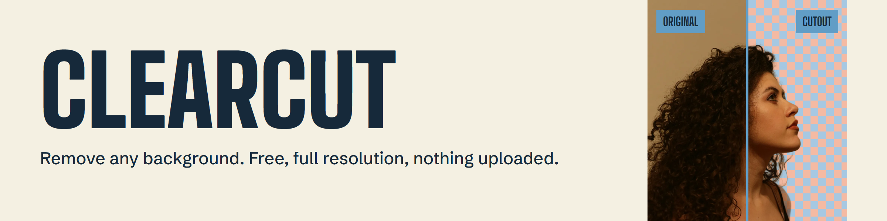
</picture>

<p align="center">
  
  
  
  
  
</p>
<p align="center">
  
  
  
  
</p>

<p align="center">
  <a href="#-quick-start"><b>Quick start</b></a> ·
  <a href="#-a-tour-of-the-app"><b>Tour</b></a> ·
  <a href="#-screenshot-gallery"><b>Gallery</b></a> ·
  <a href="#-architecture"><b>Architecture</b></a> ·
  <a href="#-security"><b>Security</b></a> ·
  <a href="#-testing"><b>Testing</b></a> ·
  <a href="#-design"><b>Design</b></a>
</p>

<br>

<p align="center">
  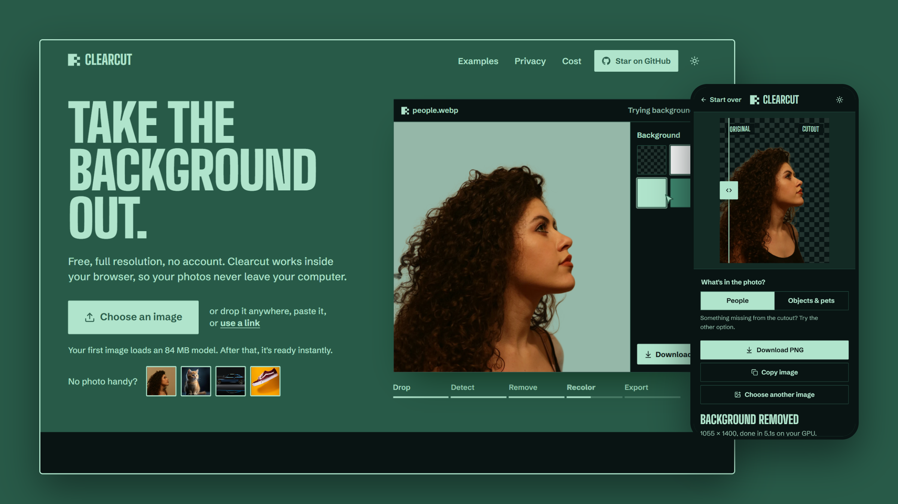
</p>

<br>

**Clearcut** removes the background from any image, for free and at full resolution. Drop in a photo, and a model running inside your browser separates the subject from the background. There's no account, no credits, no watermark and no server to send your photo to.

**Check the privacy claim yourself:** open your browser's Network tab and drop in an image. There is no upload request.

<table>
  <tr>
    <td align="center" width="25%"><h2>$0</h2><sub>free to use,<br>with no limits</sub></td>
    <td align="center" width="25%"><h2>0 bytes</h2><sub>of your photo<br>ever leave your device</sub></td>
    <td align="center" width="25%"><h2>~3.8 s</h2><sub>per photo on a graphics card,<br>in testing</sub></td>
    <td align="center" width="25%"><h2>8192 px</h2><sub>on the longest side,<br>kept at full resolution</sub></td>
  </tr>
</table>

<br>

## ✦ Highlights

<table>
  <tr>
    <td width="33%" valign="top">
      <h3>🔒 Nothing gets uploaded</h3>
      The model runs in a Web Worker on your own device, so your photos stay with you. The site is static, with no backend and no API keys.
    </td>
    <td width="33%" valign="top">
      <h3>🖼️ Full resolution</h3>
      The mask is scaled up and applied to your original pixels, so the output matches your image's size. Export a transparent PNG or WebP, or flatten it onto a color.
    </td>
    <td width="33%" valign="top">
      <h3>✂️ Two models, one click</h3>
      One is tuned for people and hair, the other for objects and pets. If something is missing from the cutout, switch and the same image runs again.
    </td>
  </tr>
  <tr>
    <td width="33%" valign="top">
      <h3>⚡ Fast where it can be</h3>
      Uses your graphics card through WebGPU, and falls back to WebAssembly on the CPU when it has to. The app remembers that choice for next time.
    </td>
    <td width="33%" valign="top">
      <h3>📥 Any way you like</h3>
      Drop a file anywhere on the page, paste from your clipboard or use an image link. Drag a divider to compare the original and the cutout.
    </td>
    <td width="33%" valign="top">
      <h3>♿ Made for everyone</h3>
      Light and dark themes, full keyboard support including the compare slider, reduced-motion support and layouts that work down to phone width.
    </td>
  </tr>
</table>

<br>

## ✦ Quick start

> [!NOTE]
> **You need** Node.js 24, which is what this project is tested on. A Chromium browser with WebGPU gives the fastest results. Without it, the app uses the CPU automatically.

**1. Get the code and install the dependencies.** You only need to do this once.

```bash
git clone https://github.com/asimhashmi47/clear-cut.git
```

```bash
cd clear-cut
```

```bash
npm install
```

**2. Start the app,** then open <http://localhost:5173>.

```bash
npm run dev
```

**3. Try a photo.** The first image in each mode loads its model (84 MB on a graphics card, 42 MB on the CPU), and later runs use the browser's cache.

<details>
<summary><b>Production build and hosting</b></summary>

<br>

Build the static site, then upload the `dist` folder to Netlify or any host that serves files. No API keys are needed.

```bash
npm run build
```

To try the production version locally, with the real security headers:

```bash
npm run preview
```

**Serve it over HTTPS.** Browsers only allow the model's integrity check on secure pages.

**Security headers.** [`public/_headers`](public/_headers) sets a strict Content Security Policy and other hardening headers on Netlify. On any other host, copy those headers into its configuration. Hosts that can't send custom headers, such as GitHub Pages, will still work but without that protection, and the CPU fallback will use a single core.

**File size limits.** The model files are 84 MB each. On a host with a smaller per-file limit, such as Cloudflare Pages, put `public/models` on a CDN and set `VITE_MODEL_HOST` (see [`.env.example`](.env.example)).

**Changing a model.** If you add or replace a model file, pin its fingerprint:

```bash
npm run hash-models
```

</details>

<p align="right"><a href="#top">↑ back to top</a></p>

## ✦ A tour of the app

<table>
  <tr>
    <td width="42%" valign="top">
      <h3>Start anywhere</h3>
      <p>The landing page shows the whole product in a looping demo: drop, detect, remove, recolor and export.</p>
      <ul>
        <li>Drop a file anywhere, paste, or use a link</li>
        <li>Four sample photos to try straight away</li>
      </ul>
    </td>
    <td width="58%">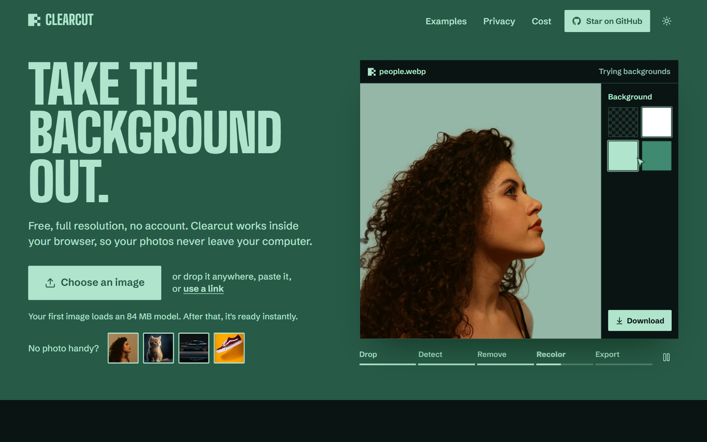</td>
  </tr>
  <tr>
    <td width="58%">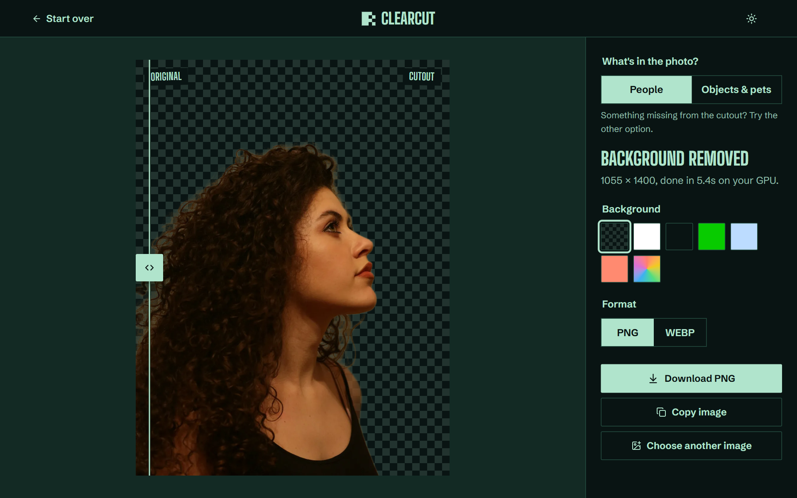</td>
    <td width="42%" valign="top">
      <h3>Studio</h3>
      <p>Your result opens beside the original, with a divider you can drag or move from the keyboard.</p>
      <ul>
        <li>The checkerboard shows exactly what became transparent</li>
        <li>Keeps your image's full resolution</li>
      </ul>
    </td>
  </tr>
  <tr>
    <td width="42%" valign="top">
      <h3>People, objects and pets</h3>
      <p>Each model is strong on one kind of subject, so you choose what's in the photo.</p>
      <ul>
        <li>ormbg for people and hair</li>
        <li>ISNet for objects and pets</li>
      </ul>
    </td>
    <td width="58%">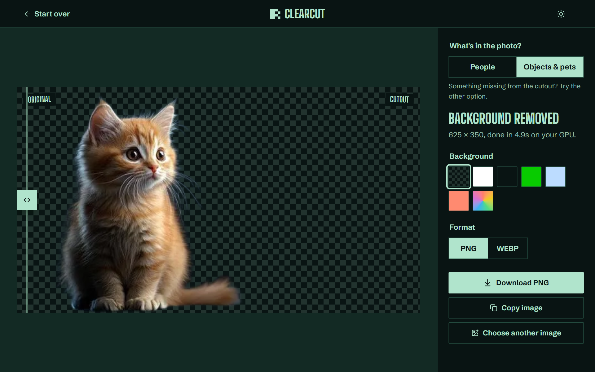</td>
  </tr>
  <tr>
    <td width="58%">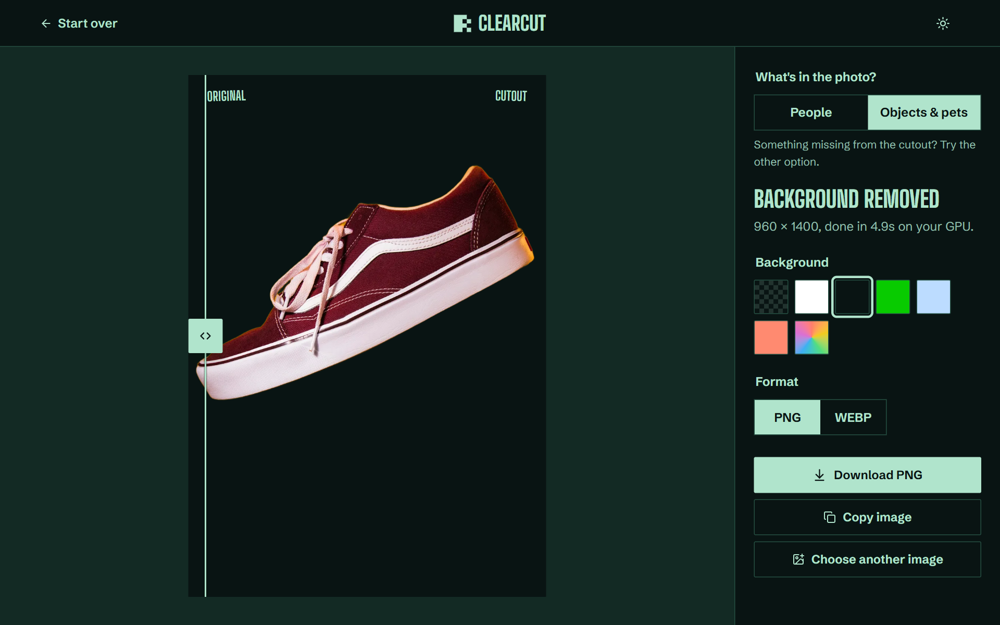</td>
    <td width="42%" valign="top">
      <h3>Export</h3>
      <p>Keep the transparency or put the subject on a solid color.</p>
      <ul>
        <li>PNG or WebP</li>
        <li>Download it or copy it to your clipboard</li>
      </ul>
    </td>
  </tr>
  <tr>
    <td width="42%" valign="top">
      <h3>Check the edges</h3>
      <p>Every example on the site is unedited output from the same models you'll run.</p>
      <ul>
        <li>Drag the divider and zoom in</li>
        <li>Open any example in the studio</li>
      </ul>
    </td>
    <td width="58%">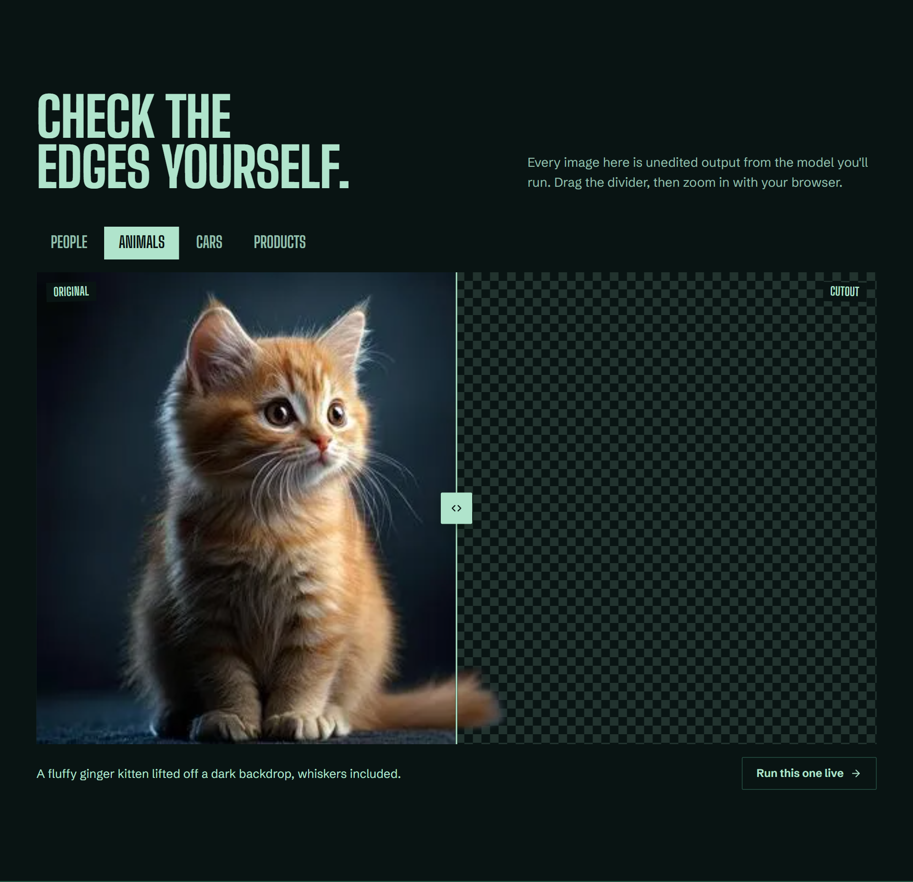</td>
  </tr>
  <tr>
    <td width="58%">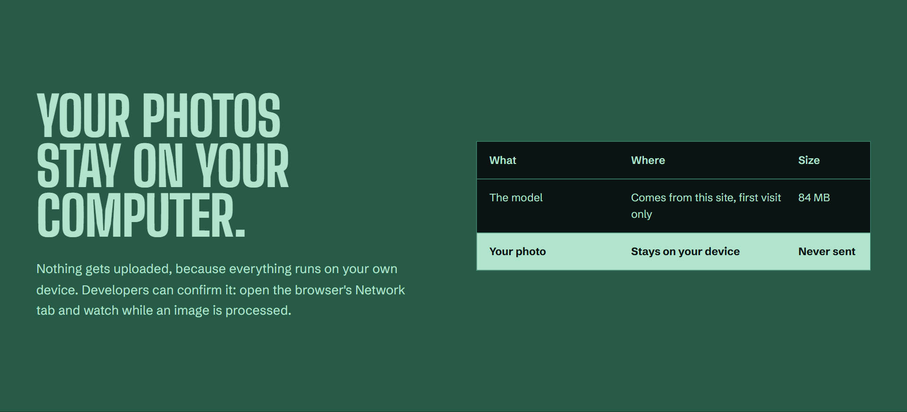</td>
    <td width="42%" valign="top">
      <h3>Private by design</h3>
      <p>The only download is the model, which comes from the site itself on the first visit.</p>
      <ul>
        <li>No requests carrying your photo</li>
        <li>Anyone can confirm it in the Network tab</li>
      </ul>
    </td>
  </tr>
</table>

<p align="right"><a href="#top">↑ back to top</a></p>

## ✦ Screenshot gallery

<details>
<summary><b>More screens</b> (click to expand)</summary>

<br>

| | |
|:---:|:---:|
| <br><sub><b>Landing</b>, dark theme</sub> | 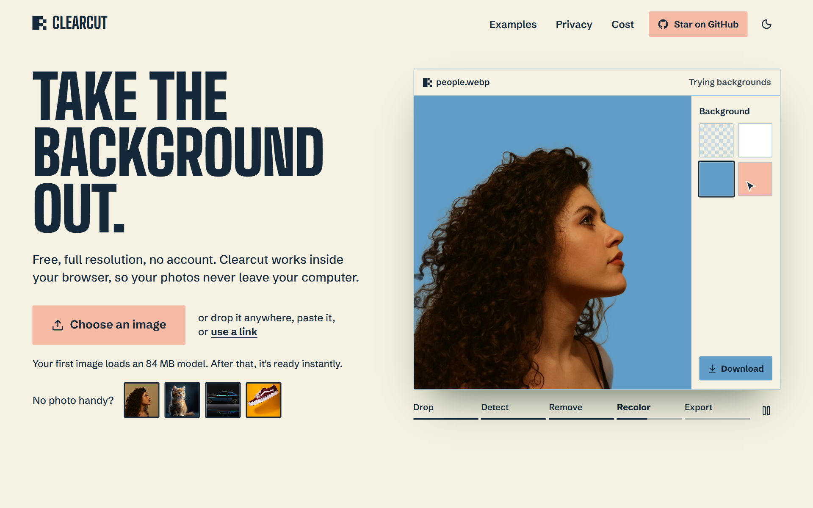<br><sub><b>Landing</b>, light theme</sub> |
| <br><sub><b>Studio</b> with hair detail</sub> | <br><sub><b>Objects and pets</b> model</sub> |
| <br><sub><b>Flatten</b> onto a color</sub> | <br><sub><b>Examples</b> with compare slider</sub> |
| <br><sub><b>Privacy</b></sub> | 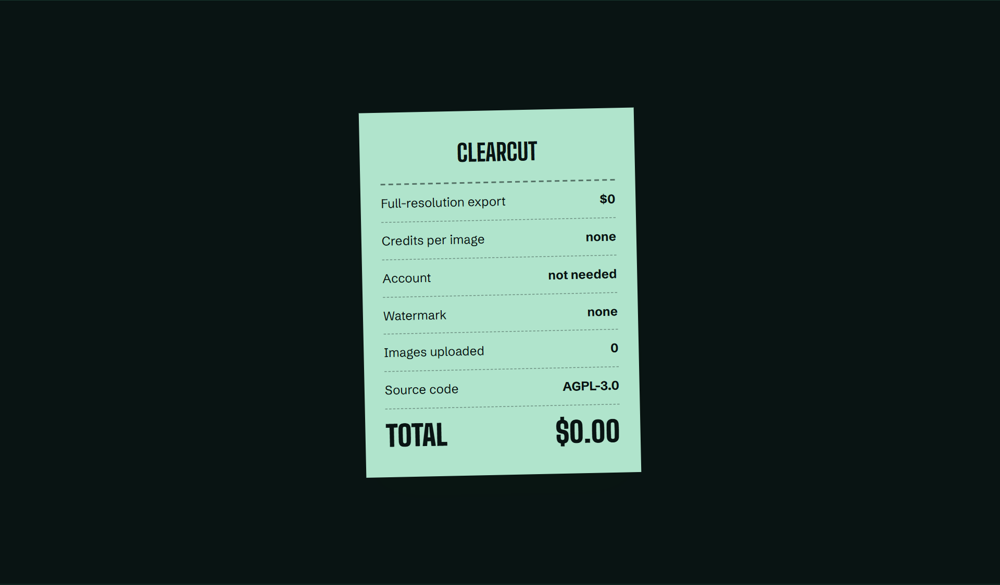<br><sub><b>Cost</b> receipt</sub> |
| 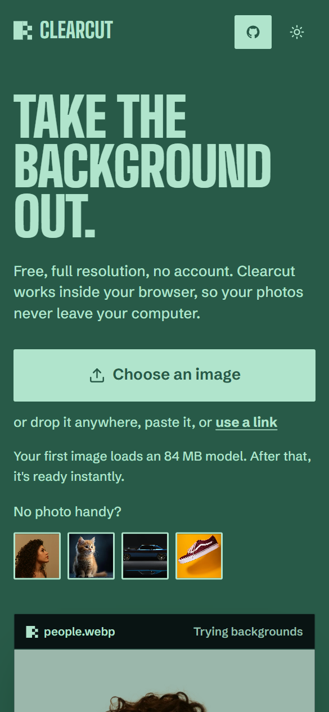<br><sub><b>Landing</b> on a phone</sub> | 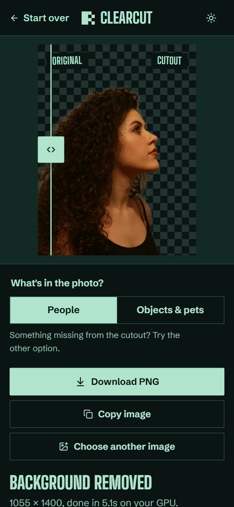<br><sub><b>Studio</b> on a phone</sub> |

</details>

<p align="right"><a href="#top">↑ back to top</a></p>

## ✦ Tech stack

<table>
  <tr>
    <th align="left" width="50%">Interface</th>
    <th align="left" width="50%">In-browser processing</th>
  </tr>
  <tr>
    <td valign="top">
      <b>React 19</b> and <b>TypeScript 7</b><br>
      <b>Vite 8</b>, built as a static site<br>
      <b>Framer Motion</b> for all animation<br>
      <b>Lucide</b> icons<br>
      <b>Big Shoulders Display</b> and <b>Schibsted Grotesk</b>, self-hosted
    </td>
    <td valign="top">
      <b>Transformers.js</b> and <b>ONNX Runtime Web</b> in a Web Worker<br>
      <b>WebGPU</b> with a <b>WebAssembly</b> CPU fallback<br>
      <b>ormbg</b> for people and <b>ISNet</b> for objects and pets<br>
      Models and runtime served from this site, with no third-party service
    </td>
  </tr>
  <tr>
    <th align="left">Quality</th>
    <th align="left">Tooling</th>
  </tr>
  <tr>
    <td valign="top">
      Node's built-in test runner for unit and integration tests<br>
      <b>Playwright</b> end-to-end tests on a production build<br>
      <b>oxlint</b> and strict type checks
    </td>
    <td valign="top">
      <b>sharp</b> and a script that regenerates the sample cutouts with the same models<br>
      SHA-256 pinning for every model file<br>
      <b>Remotion</b> project for a launch video
    </td>
  </tr>
</table>

## ✦ Architecture

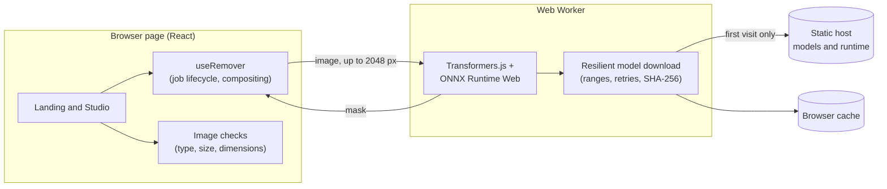

### The life of an image

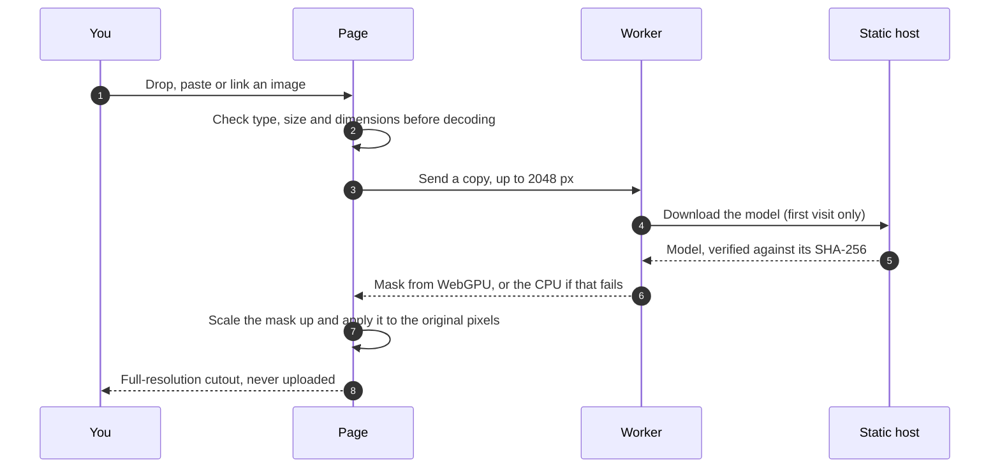

<p align="right"><a href="#top">↑ back to top</a></p>

## ✦ Security

Nothing is uploaded, so the main risks are hostile images, hostile links and tampered model files. Each protection below has a regression test.

<details>
<summary><b>Images and links</b></summary>

- Image dimensions are read from the file header before decoding. Anything above 120 megapixels is refused, so a tiny file can't expand to gigabytes in memory.
- A file must really be a JPEG, PNG, WebP or AVIF, whatever its name says.
- Files are limited to 40 MB. Link downloads stop reading at that limit, even when the server hides the size.
- Link downloads show that they're working and stop after 30 seconds. Only `http` and `https` links are accepted.

</details>

<details>
<summary><b>Model integrity</b></summary>

- Every model file is pinned to a SHA-256 hash. A mismatched or unknown model is refused and never cached.
- Models and the runtime come from the site itself, so no third-party service is involved.
- A model already in the browser's cache isn't checked again.

</details>

<details>
<summary><b>Headers and known limits</b></summary>

- [`public/_headers`](public/_headers) sets a strict Content Security Policy, `X-Content-Type-Options`, `Referrer-Policy` and HSTS. The app runs with no violations.
- The policy has to allow connections to any website, because the image link feature needs it.
- Headers only apply where the host sends them, so GitHub Pages doesn't get this protection.
- Pasted links are fetched immediately, and the site can currently be framed by other sites.

</details>

## ✦ Testing

Tests are written first. End-to-end tests run a production build in Chrome with the real models and the real security headers.

| Suite | Result |
|---|---|
| Unit tests | **180 passed** |
| Integration tests | **32 passed** |
| End-to-end tests (Playwright) | **35 passed** |
| Line coverage on the logic modules | **99.78%** |
| Lint, type checks and build | **Clean** |
| `npm audit` | **0 vulnerabilities** |

<sub>Tested in Chrome on Windows. Safari, Firefox and real phones haven't been tested yet.</sub>

## ✦ Design

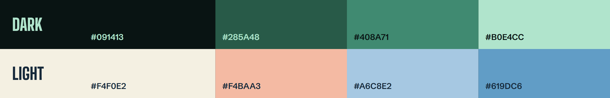

The identity comes from the film set: gaffer-tape labels, a scan line, and the transparency checkerboard showing wherever a background has been removed. The dark theme uses `091413 285A48 408A71 B0E4CC`, and the light theme uses `F4F0E2 F4BAA3 A6C8E2 619DC6`. Type is set in Big Shoulders Display and Schibsted Grotesk. See [PRODUCT.md](PRODUCT.md) for the brand notes.

## ✦ Project layout

```
src/
  components/               Landing, Studio, HeroDemo, CompareStage
  lib/
    removal.worker.ts       model loading and processing
    useRemover.ts           job state and final compositing
    resilientFetch.ts       chunked, verified model download
    imageSize.ts            dimension checks before decoding
    linkImage.ts            image link downloads
  config.ts                 app name, repository link and the two models
public/
  models/                   the two models
  samples/                  showcase images, real model output
  _headers                  security headers
scripts/
  generate-samples.mjs      regenerates the showcase images
  hash-models.mjs           pins the model fingerprints
video/                      Remotion launch video
images/                     screenshots and README artwork
```

## ✦ Credits

- People mode by [ormbg](https://huggingface.co/onnx-community/ormbg-ONNX) (Apache 2.0)
- Objects and pets mode by [ISNet](https://huggingface.co/onnx-community/ISNet-ONNX) (AGPL-3.0)
- Processing by [Transformers.js](https://github.com/huggingface/transformers.js) (Apache 2.0)
- Sample photos from [Unsplash](https://unsplash.com), under the Unsplash License, except the kitten in `public/samples/animal.webp` and `animal-cutout.webp`, which is from [Vecteezy](https://www.vecteezy.com) under Vecteezy's terms and not covered by this project's license
- Type set in Big Shoulders Display and Schibsted Grotesk (SIL Open Font License)

## ✦ License

[GNU AGPL-3.0](LICENSE). If you run a modified version as a public service, you must offer your source code to its users. The models in `public/models` are third-party files under the licenses listed in Credits.

<br>

<div align="center">

**Clearcut** · free and open source

© 2026 [masimaziz.com](https://masimaziz.com/) · [asimhashmi47@gmail.com](mailto:asimhashmi47@gmail.com)

<a href="#top">↑ back to top</a>

</div>
